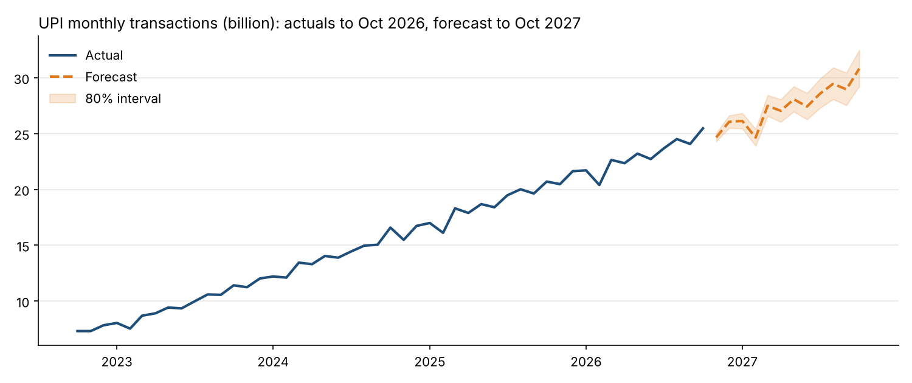
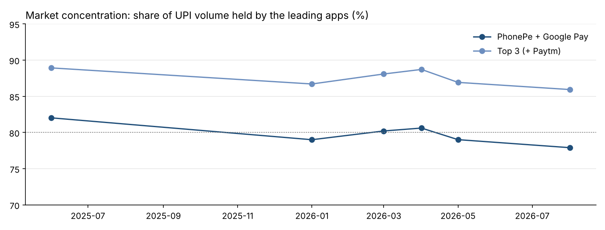

# UPI Ecosystem Analytics: India's Digital Payments, Market Concentration & 12-Month Forecast

An end-to-end analytics project on India's Unified Payments Interface (UPI), covering 49 months of NPCI data (Oct 2022 – Oct 2026). It has an automated Python pipeline, a star-schema Power BI model, 30+ DAX measures, and a back-tested time-series forecast.

**Business question:** How fast is UPI still growing, who controls it, and what happens to the market leaders if NPCI enforces its proposed 30% per-app volume cap?



---

## Key insights (as of Oct 2026)

| # | Finding | So what |
|---|---|---|
| 1 | Monthly volume rose **3.5×**, from 7.3 bn (Oct 2022) to **25.5 bn** (Oct 2026), a **36.6% CAGR**. Growth has slowed to **23% YoY**. | UPI is moving from hyper-growth into a mature phase, so growth now has to come from new use cases (credit on UPI, international payments, UPI Lite). |
| 2 | **Average ticket size fell ~25%, from ~₹1,657 (Oct 2022) to ~₹1,238 (Oct 2026).** | Transaction counts are growing faster than value because UPI now handles small everyday payments, which make up much of the cash economy. |
| 3 | **Merchant (P2M) payments are ~63% of transactions but only ~29% of value** (Feb 2026). | Most merchant payments are low value. Revenue models that charge on transaction value (MDR) will struggle, and volume-based services (merchant software, lending) are more promising. |
| 4 | **PhonePe + Google Pay hold ~78% of volume** (Aug 2026), down from ~82% in Jun 2025. The top 3 hold ~86%, down from 95% in Jan 2024. HHI is still above 3,000. | The market is still **highly concentrated**. Both leaders are well above the proposed **30% cap**, so enforcing it would push about 18 percentage points of share (15.6 from PhonePe, 2.3 from Google Pay) toward challengers like Navi and super.money. |
| 5 | The forecast puts monthly volume at **~30.8 bn by Oct 2027** (80% interval: 29.2–32.5 bn), with a 6-month back-test error of **0.3% MAPE**. | Capacity planning at NPCI and the banks should assume about 330 bn transactions in the next 12 months. |



---

## Architecture

```
NPCI data ──► data/raw/ (official CSV, optional) ─┐
              data/seed/ (verified fallback)      ─┴► pipeline/run_pipeline.py
                                                        │  clean · derive KPIs · forecast · concentration
                                                        ▼
                                            data/model/  (star schema CSVs + run_log.json)
                                                        ▼
                                Power BI (Power Query → model → DAX → 6 report pages)
```

**Star schema**
- Dimensions: `dim_date` (monthly, with Indian fiscal year Apr–Mar and festive-season flag) and `dim_app`
- Facts: `fact_upi_monthly`, `fact_forecast`, `fact_app_share`, `fact_concentration`, `fact_p2p_p2m`

**Forecasting:** Holt-Winters (additive trend plus 12-month seasonality) on log volume. It was chosen over SARIMA variants because it had the lowest 6- and 12-month back-test error (0.29% / 0.52% MAPE) and a growth path consistent with recent YoY growth. The 80% intervals come from the residual standard deviation, widening with the horizon.

**Report pages:** Executive Overview · Growth & Seasonality · App Market Share · P2P vs P2M · Forecast · Insights & Recommendations, plus a hidden **Month Detail** drill-through page and a **report-page tooltip**. Bookmarks + buttons on the overview switch between the volume/value and ticket-size views.

**Portable:** `refresh.bat` rewrites the Power BI data-folder parameter to wherever the project now lives, so the folder can be moved or cloned anywhere.

## Run it

```bash
pip install -r requirements.txt
python pipeline/run_pipeline.py      # or double-click refresh.bat on Windows
```
Then open the `.pbix` and click **Refresh**. Full build steps are in [BUILD_GUIDE.md](BUILD_GUIDE.md).

## Skills demonstrated
Power Query (parameterised, function-based loading) · dimensional modelling · DAX (time intelligence with EDATE, iterators, TOPN, dynamic titles, conditional formatting measures) · Python ETL (pandas) · time-series forecasting & back-testing (statsmodels) · market-concentration analysis (HHI) · data storytelling

## Data sources & caveats
- Monthly volume and value come from **NPCI**, compiled via Dataful (dataset 432), India Dispatch (CC BY 4.0), PIB / Ministry of Finance, and press coverage of NPCI releases. Each row's source is in `fact_upi_monthly[source]`.
- All 49 months have both volume and value. Values for months not in the Dataful extract were taken from NPCI's monthly releases as reported by PTI, Business Standard, Inc42 and the Ministry of Finance; each row's source is in `fact_upi_monthly[source]`. Dropping the official NPCI file into `data/raw/` replaces the seed automatically.
- App market shares come from NPCI app-wise data as reported by Business Standard, Inc42, StartupTalky, Angel One and others. Publishers sometimes use slightly different bases (all apps vs. top apps), so month-to-month moves under ~1 percentage point should be read with caution.
- The HHI is a **lower bound**, because the long tail ("Others") is treated as fully fragmented.
- The 30% per-app cap is an NPCI **proposal**. Check its current status before presenting.

---

### Resume bullets (pick 2–3)
- Built an automated **Power BI + Python** analytics pipeline on 49 months of NPCI UPI data (25 bn+ monthly transactions), modelled as a **star schema** with 30+ DAX measures across 6 interactive report pages.
- Forecast UPI volume 12 months ahead with **Holt-Winters on log-transformed data**, selected over SARIMA by back-testing (**0.3% MAPE**), projecting ~30.8 bn monthly transactions by Oct 2027.
- Quantified market concentration (**HHI > 3,000; top-2 share 78%**) and modelled the impact of NPCI's proposed 30% app cap, which would shift ~18 percentage points of volume to challenger apps.
